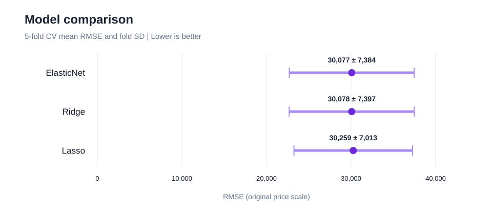

# Ames Housing Price Prediction

## Overview

Ames 주택 특성으로 **판매가를 예측**하고 Ridge, Lasso, ElasticNet의 오차를 비교. 모델별 평균 오차와 교차검증 fold의 변동성을 함께 확인.

  

## Data

| Item | Details |
|---|---|
| Source | Ames Housing, De Cock (2011) 기반 과제 데이터 |
| Train | **2,344행**, 타깃 포함 사용 컬럼 31개 |
| Private Test | **586행**, 정답 라벨 없이 최종 예측에만 사용 |
| Target | 주택 판매가 `sale_price`, 원본 금액 단위 유지 |
| Features | 면적, 입지, 품질, 건축 연도 등 주택 특성 |
| Metric | **RMSE**, 예측 오차를 가격 단위로 나타낸 값이며 작을수록 좋음 |

원자료는 저장소에 미포함. 입력 파일과 변수 정의는 [Data 안내](data/README.md) 참조.

## Research Design

1. **평가용 데이터 분리**

   - 학습 자료의 **20%를 held-out으로 분리**
   - 모델 선택에는 사용하지 않고 최종 성능 확인에 사용

2. **결측값과 범주 처리**

   - 시설이 없는 경우는 별도 값으로 구분하고 나머지 결측값은 중앙값 또는 최빈값으로 대치
   - 품질 등급은 **순서형 인코딩**, 지역과 건물 유형은 **원-핫 인코딩** 적용

3. **면적과 연령 변수 생성**

   - `total_sf`: 지하 면적과 지상 거주면적의 합
   - `house_age`: 판매 연도에서 건축 연도를 뺀 주택 연령
   - 수치형 변수 표준화, 모든 전처리는 **Pipeline 안에서 fold별 학습**

4. **규제 선형모형 비교**

   - **Ridge:** 계수 크기를 제한하는 방식
   - **Lasso:** 일부 계수를 0으로 만드는 방식
   - **ElasticNet:** 두 규제를 결합하는 방식, 규제 강도와 혼합 비율은 **GridSearchCV**로 선택

5. **선택과 성능 측정 분리**

   - **Nested CV:** 안쪽 fold에서 설정을 선택하고 바깥쪽 fold에서 오차 측정
   - 모델별 CV RMSE와 fold 표준편차 비교, held-out에서 별도 평가

6. **최종 예측과 해석**

   - 전체 학습 자료로 ElasticNet을 재학습해 **Private Test 가격 예측**
   - 학습된 계수로 가격과 주택 특성의 관계 확인

## Analysis Workflow


## Key Results

### Model Comparison

- 기존 5-fold CV 결과에서 **ElasticNet RMSE 30,077**, Ridge 30,078, Lasso 30,259 기록
- 모델 간 최대 차이는 **182**, fold 표준편차는 **7,013~7,397**로 평균 차이보다 큼. 이 결과만으로 특정 모델의 우월성을 단정하기 어려움
- 최종 모델은 **ElasticNet** 사용

<p align="center">
  
</p>
<p align="center"><sub>기존 cv_results.csv의 평균 RMSE와 ±1 fold 표준편차. 신뢰구간이나 Nested CV 결과가 아님.</sub></p>

### Held-out Performance

- 학습 자료에서 분리한 **20% held-out** 기준 **RMSE 22,446**, **R² 0.907** 기록
- 단일 분할 결과이며, 앞의 CV 평균과는 평가 표본 및 방식이 다름

## Limitations

- **분할 민감성:** fold별 오차 변동이 커 평균 점수만으로 모델 간 차이를 판단하기 어려움
- **적용 범위:** Ames 주택 자료의 결과이며 다른 지역이나 시점의 성능은 확인되지 않음
- **계수 해석:** 전처리와 다른 변수의 영향을 함께 받은 예측 계수이며 인과효과를 의미하지 않음
- **Private Test:** 정답 라벨이 없어 저장된 예측만으로 성능 계산 불가

## Repository Structure

```text
├── notebooks/   # 최종 모델 코드와 실행 안내
├── results/     # 모델 비교, 결과 그림, 예측 파일
├── reports/     # 분석 보고서
├── data/        # 데이터 배치와 변수 안내
└── audit/       # 기존 모델 검토 기록
```

[Notebooks](notebooks/README.md), [Results](results/README.md), [Reports](reports/README.md)

