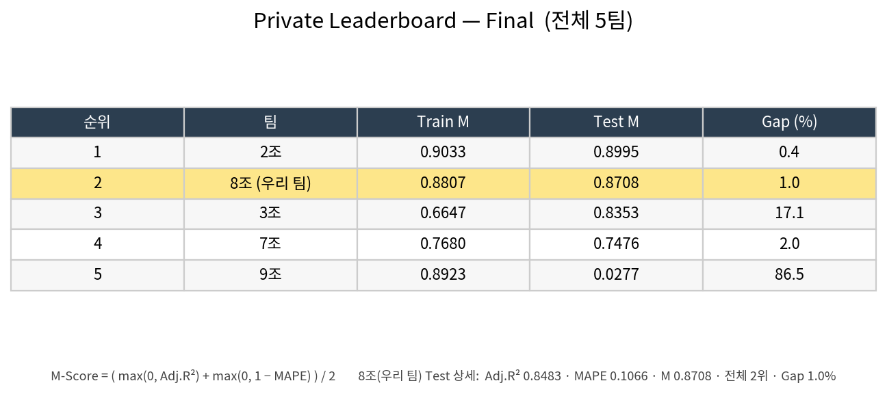
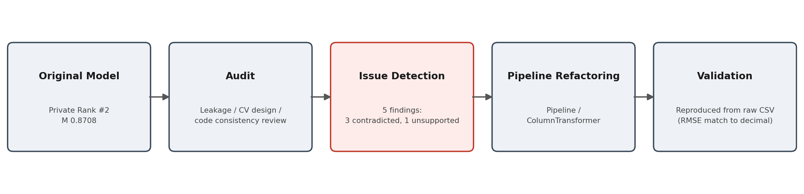

# Ames Housing Price Prediction
### 내가 만든 모델을 스스로 감사하다 — 코드–보고서 불일치를 찾아 고친 기록

**The model in the report was not the model I submitted. I found it by auditing my own work.**

Ames Housing 주택 가격 회귀 프로젝트. 모델을 완성한 뒤 직접 감사(audit)해 코드–보고서 불일치·dead code·데이터 누수를 찾아내고, 재현 가능한 형태로 수정한 기록


<p align="center">
  <br>
  <sub><b>Figure 1.</b> Private Test M <b>0.8708 · 전체 2위 · Train–Test Gap 1.0%</b>. 단, 감사 결과 이 2위는 보고서가 "핵심"이라 설명한 파생변수 <b>없이</b> 달성된 것 — 그 정보는 이미 원천 변수에 담겨 있었다.</sub>
</p>

> 대회 원본 CSV는 라이선스상 미포함(`.gitignore`). 코드·노트북·감사 보고서·결과표만 공개. → [`data/data_description.md`](data/data_description.md)

---

## 30초 요약

**질문.** 좋은 리더보드 점수가 곧 신뢰할 수 있는 분석인가. 내가 보고한 모델은 실제로 내가 제출한 모델과 같은가.

**핵심 발견.**
- Private 2위(M 0.8708, Gap 1.0%)는 보고서가 "핵심"이라던 파생변수 **없이** 달성 — 제출 모델은 74 feature, 파생변수 부재.
- 희귀범주 병합은 **dead code**였고, 변수중요도 해석은 산출 코드가 **없었다**.
- 전처리를 CV 밖에서 fit한 **스케일링 누수** 존재(영향은 소, 약 50 RMSE).
- 5개 지적 중 3개 CONTRADICTED · 1개 UNSUPPORTED — 모두 원본 CSV로 재현해 확인.

**방법.** 규제 선형회귀(Ridge·Lasso·ElasticNet) 5-Fold CV 튜닝 → 자기 감사(누수·CV 설계·코드 정합성) → `Pipeline`/`ColumnTransformer`로 구조적 수정.

**의미.** 이 저장소의 핵심은 점수가 아니라 **코드가 보고서대로 동작하는지 검증하고 고치는 과정**이다.

---

## 왜 중요한가

대부분의 포트폴리오는 가장 좋은 결과만 보여준다. 이 프로젝트는 반대로, 이미 2위를 한 모델을 **가장 엄격한 기준(데이터 누수·교차검증 설계)으로 스스로 재검토**한 기록이다. 기존 분석을 방어하지 않고, 모든 지적을 원본 CSV로 재현해(원본 CV RMSE 30,129.947을 소수점까지 복원) 경험적으로 확인했다.

결과적으로 헤드라인 모델은 보고서가 설명하는 모델과 달랐다. 좋은 점수가 정직한 보고서를 보장하지 않으며, 그 간극을 찾아 고치는 과정이 이 프로젝트가 보여주려는 역량이다.

## 내 역할

- **개인 프로젝트** — 모델링·감사·수정 전 과정 단독 수행
- **목표 전환** — 초기 목표(예측 성능) → 결과 재검증·수정
- **전 과정 수행** — 모델링 → Self-Audit → 구조적 수정

---

<details>
<summary><b>데이터</b></summary>

<br>

| 항목 | 내용 |
|---|---|
| 데이터셋 | Ames Housing (De Cock, 2011) — 아이오와 주택 거래 |
| 규모 | 학습 2,344행 · 31개 변수 (수치형 16 · 범주형 15) · 타깃 `sale_price` |
| 타깃 분포 | 양의 왜도(약 1.75), 우측 꼬리 — 고가 주택은 이상치가 아닌 실제 패턴으로 보고 삭제 대신 규제로 대응 |
| 결측 처리 | 구조적(시설 없음 → `None`/`0`)과 비구조적(Train 기준 중앙값/최빈값) 구분, 모든 통계는 **Train 기준** |

> 변수 처리 상세: [`data/data_description.md`](data/data_description.md).

</details>

---

## 기술 스택

| 구분 | 도구 |
|---|---|
| 언어 | Python 3.x |
| 데이터 처리 | pandas · numpy |
| 모델·검증 | scikit-learn — Ridge · Lasso · ElasticNet · `Pipeline` · `ColumnTransformer` · `GridSearchCV` |
| 직렬화 | joblib (`model.pkl`) |
| 시각화 | matplotlib · seaborn |

---

<details>
<summary><b>모델링 — 세 모델은 통계적으로 동등</b></summary>

<br>

Ridge·Lasso·ElasticNet을 5-Fold CV(`shuffle=True, random_state=42`) `GridSearchCV`로 튜닝.

| 모델 | CV RMSE | fold 표준편차 |
|---|:---:|:---:|
| ElasticNet (α=0.01, l1=0.5) | 30,077 | ± 7,384 |
| Ridge (α=10) | 30,078 | ± 7,397 |
| Lasso (α=1.0) | 30,259 | ± 7,013 |

모델 간 평균 차이(약 180) ≪ fold 표준편차(약 7,300) → 세 모델은 통계적으로 동등. 최종 모델은 성능 우위가 아니라 **단순성·계수 안정성**을 근거로 ElasticNet 선택. ("최고/가장 견고"라는 주장은 데이터가 뒷받침하지 않아 하지 않음.)

</details>

---

## 자기 감사 (Self-Audit)

이 프로젝트의 핵심. 완성된 노트북을 데이터 누수·교차검증 설계·코드 정합성 관점에서 재검토하고, 모든 지적을 원본 CSV로 재현해 판정했다.

<p align="center">
  <br>
  <sub><b>Figure 2.</b> Self-Audit 프로세스 — 완성된 모델을 감사 기준으로 재검토해 구조적으로 수정한 흐름.</sub>
</p>

### 발견된 문제

| # | 문제 | 검증 | 판정 |
|---|---|---|---|
| 1 | 파생변수(`total_sf`,`house_age`)가 변수 덮어쓰기로 제출 모델에서 누락 | 제출 파일 74 feature(파생 부재) 확인 | CONTRADICTED |
| 2 | 희귀범주(Rare) 병합이 `df_train`만 수정 → dead code | `X_train`에 `'Rare'` 없음 | CONTRADICTED |
| 3 | 변수중요도 해석에 산출 코드 없음 | 전 셀 검토 | UNSUPPORTED |
| 4 | 전처리가 CV 밖에서 fit → 스케일링 누수 | 누수 전후 CV 비교(영향 약 50 RMSE) | 사실, 영향 소 |
| 5 | 버전 불일치: `과정기록`(파생 포함) vs 제출 모델(파생 미포함) | 두 파일 비교 | CONTRADICTED |

> 즉, Private 2위 성과는 파생변수 없이 달성된 것이며 그 정보는 원천 변수(`gr_liv_area` 등)에 이미 담겨 있었다. 전체 감사 보고서: [`audit/audit_report.md`](audit/audit_report.md).

### 수정 내용

| 항목 | Before | After |
|---|---|---|
| 파생변수 | 모델에서 누락 | `FunctionTransformer`로 Pipeline에 반영 |
| 희귀범주 | dead code | `OneHotEncoder(min_frequency=0.01)` |
| 전처리 | CV 밖 fit (누수) | `Pipeline`/`ColumnTransformer` 내부 fit |
| 성능 보고 | 그리드 최솟값(낙관) | Nested CV + held-out |
| 변수중요도 | 근거 코드 없음 | 계수 직접 산출 |
| 재현성 | 비멱등 | 멱등(Run-All 안정) |

---

## 최종 결과

- Private Test M **0.8708 / 전체 2위 / Train–Test Gap 1.0%** (대회 리더보드).
- 누수 제거 후 CV RMSE ≈ 30,100 (±7,300).
- 실제 가격 결정 요인(계수 기준): **입지(Neighborhood) > 건물 유형 > 지상 면적 > 전반 품질**.
- 동일 과제에서 한 팀이 Gap 86%로 붕괴한 것과 달리 Gap 1.0% → 안정적 일반화의 근거.

---

## 핵심 요약

- CV 점수 차이는 fold 표준편차와 함께 해석해야 한다 — 작은 차이로 우열을 주장하면 안 된다.
- 좋은 결과 ≠ 정직한 보고서. 코드가 보고서대로 동작하는지는 별도 검증이 필요하다.
- `Pipeline`/`ColumnTransformer`로 데이터 누수를 구조적으로 차단한다.
- Private Test의 작은 Gap이 일반화의 진짜 증거다.

---

<details>
<summary><b>재현</b></summary>

<br>

```bash
git clone https://github.com/jiwooo411/Real-Estate-Price-Prediction.git
cd Real-Estate-Price-Prediction
pip install -r requirements.txt

jupyter notebook notebooks/01_final_model_corrected.ipynb   # 누수 없는 재구현 (대표)
jupyter notebook notebooks/02_report_annotated.ipynb        # 원본 보고서 + Audit 정정
```

원본 CV RMSE 30,129.947을 소수점까지 재현, 저장 모델(`results/model.pkl`) reload 예측 일치 확인. 누수 없는 대표 노트북은 Run-All로 동일 결과 산출(멱등). 대회 원본 데이터는 라이선스상 미포함.

</details>

<details>
<summary><b>협업 규칙</b></summary>

<br>

개인 저장소이지만 협업 흐름 적용. AI 에이전트(Claude · Codex 등) 작업 시에도 동일 규칙 준수. 상세: [`CONTRIBUTING.md`](CONTRIBUTING.md).

- **흐름.** `main` pull → 작업 브랜치 → commit → push → PR → 리뷰 → merge.
- **브랜치 네이밍.** `<type>/<short-topic>`. `claude/*`·`codex/*` 임의 브랜치 금지.
- **커밋.** [Conventional Commits](https://www.conventionalcommits.org) — `feat`·`fix`·`docs`·`refactor`·`chore`.

</details>

---

## 저장소 구조

```
.
├── README.md · CONTRIBUTING.md · requirements.txt
├── notebooks/
│   ├── 01_final_model_corrected.ipynb   # 대표: 누수 없는 재구현
│   └── 02_report_annotated.ipynb        # 원본 보고서 + Audit 정정
├── audit/
│   └── audit_report.md                  # 감사 보고서 (C1~C4 · M1~M7)
├── reports/
│   ├── original_report.pdf · corrected_report.pdf
│   └── process_log.ipynb                # 탐색 기록(참고)
├── results/
│   ├── leaderboard_result.png · submission_test.csv
│   ├── cv_results.csv · model.pkl
└── data/
    └── data_description.md              # 원본 데이터는 비공개(.gitignore)
```

---

<sub>모든 수치는 실제 데이터로 재현·검증됨 · 데이터셋: Ames Housing (De Cock, 2011) · 대회 원본 데이터는 라이선스상 미포함.</sub>
